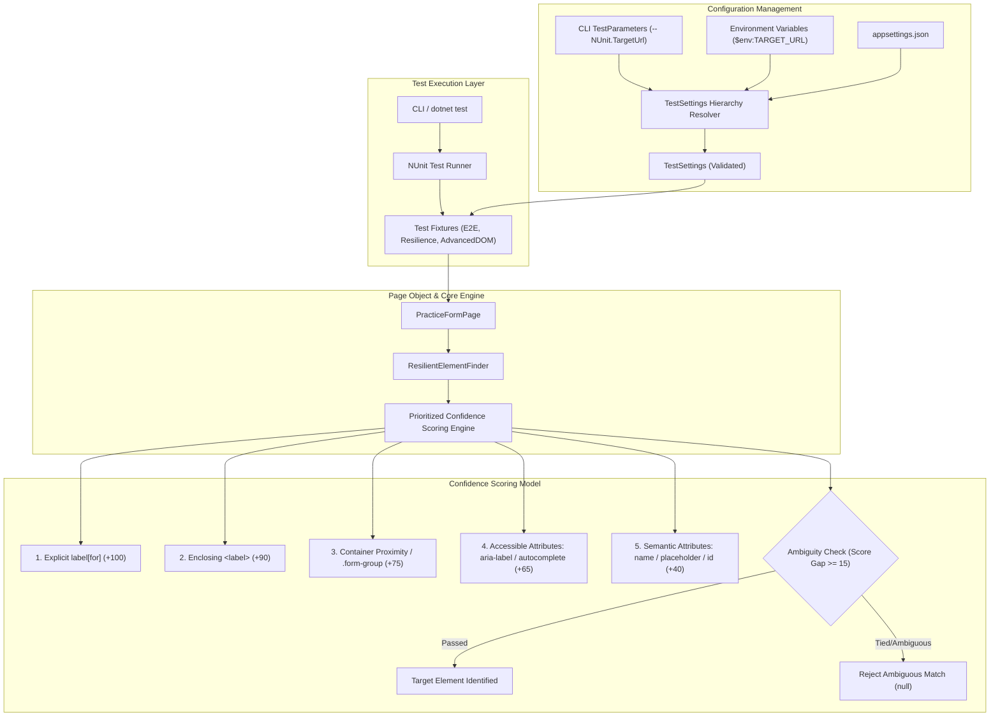

# CloudQA Resilient Selenium Automation (Task 1)

Professional C# and Selenium WebDriver test automation suite designed to reliably automate and verify web forms across dynamic DOM structures, field reordering, altered HTML attributes, and responsive layouts without relying on brittle fixed XPath or CSS selectors.

---

## 1. Project Overview & Requirements

This project fulfills **Task 1: Automation that keeps working when the page changes**.

* **Target URL**: `https://app.cloudqa.io/home/AutomationPracticeForm`
* **Core Automated Fields**:
  1. **First Name** (`<input type="text">`): Discovered semantically; configurable text entered and verified.
  2. **Gender** (`<input type="radio">`): Field group identified; requested option (`Male`, `Female`, `Other`) selected and verified.
  3. **State** (`<select>` dropdown): Associated select located; configurable option selected via `SelectElement` and verified.
* **Resilience Objectives**:
  * Fields may appear in different visual or DOM orders.
  * Element `id`, `name`, and `class` attributes may be dynamically generated or changed.
  * HTML structure may vary (nested within `div.form-group`, tables, fieldsets, or custom wrappers).
  * URL and field values must be fully configurable via CLI, Environment Variables, or JSON configuration.
  * Ambiguous matches are detected and rejected rather than guessing incorrectly.

---

## 2. Technology Stack

| Component | Version | Purpose |
| :--- | :--- | :--- |
| **Language / Runtime** | C# (.NET 10.0) | Core programming language & runtime |
| **Selenium WebDriver** | `4.52.0` | Browser automation engine |
| **Selenium Support** | `4.52.0` | Enhanced automation helpers (`SelectElement`, UI wait utilities) |
| **NUnit** | `5.0.0` | Test framework & assertion library |
| **NUnit3TestAdapter** | `6.3.1` | Visual Studio & CLI test execution adapter |
| **Microsoft.Extensions.Configuration** | `10.0.14` | Hierarchical configuration management |

---

## 3. Architecture & Locator Strategy



### Prioritized Confidence Scoring Engine

Rather than relying on fragile fixed selectors (`//div[2]/div/input` or `#fname`), the `ResilientElementFinder` evaluates elements using multi-signal confidence scoring:

1. **Explicit Label Association (`+100 pts`)**: Matches `<label for="target_id">` to element IDs using semantic aliases.
2. **Enclosing Label Association (`+90 pts`)**: Detects inputs nested inside `<label>First Name <input/></label>`.
3. **Container Proximity (`+75 pts`)**: Uses DOM relationship queries to detect labels sharing a common field container (`.form-group`, `.field`, `.row`).
4. **Accessible Attributes (`+65 pts`)**: Reads `aria-label`, `aria-labelledby`, and `autocomplete="given-name"`.
5. **Semantic Attributes (`+40 pts`)**: Matches placeholder text, attribute names, or normalized IDs.
6. **Ambiguity Prevention**: If two top-scoring candidates tie in confidence, the locator engine logs a diagnostic warning and rejects the ambiguous match to prevent false-positive form fills.

---

## 4. Test Suites & Categories

The solution is partitioned into distinct test categories:

1. **`Category=Resilience` (`ResilienceControlledTests.cs`)**:
   * Fast, in-memory HTML fixtures simulating DOM mutations, reverse field orders, scrambled IDs/classes, tied confidence scores, and missing fields.
2. **`Category=E2E` (`PracticeFormTests.cs`)**:
   * Tests against the live target URL (`https://app.cloudqa.io/home/AutomationPracticeForm`).
   * Validates individual field entry, verification, all 3 required fields end-to-end, and full 16-field form completion.
3. **`Category=AdvancedDOM` (`AdvancedDomTests.cs`)**:
   * Evaluates open Shadow DOM (`<shadow-form>`) and embedded `<iframe>` traversal in dedicated, isolated fixtures.

---

## 5. Execution Commands

### Prerequisites
* [.NET 10.0 SDK](https://dotnet.microsoft.com/)
* Google Chrome installed

### Step 1: Restore & Build
```powershell
dotnet restore
dotnet build
```

### Step 2: Run Controlled Resilience Tests (Recommended Quick Check ~15s)
Runs unit-level resilience fixtures without external network dependencies:
```powershell
dotnet test --filter "Category=Resilience" -- NUnit.Headless="true"
```

### Step 3: Run Core 3-Field Live Automation Test
Executes the specific Task 1 assignment requirement (First Name, Gender, State entry, verification, and submit):
```powershell
dotnet test --filter "FullyQualifiedName~Test_04_All_Three_Required_Fields_EndToEnd_Automation" -- NUnit.TargetUrl="https://app.cloudqa.io/home/AutomationPracticeForm" -- NUnit.Headless="true"
```

### Step 4: Run Complete E2E Suite (Headless)
Runs all 5 live practice form tests:
```powershell
dotnet test --filter "Category=E2E" -- NUnit.TargetUrl="https://app.cloudqa.io/home/AutomationPracticeForm" -- NUnit.Headless="true"
```

### Step 5: Run with Visible Browser GUI (Headful)
```powershell
dotnet test --filter "FullyQualifiedName~Test_04_All_Three_Required_Fields_EndToEnd_Automation" -- NUnit.TargetUrl="https://app.cloudqa.io/home/AutomationPracticeForm" -- NUnit.Headless="false"
```

### Step 6: Run Against a Modified Test URL
Provide a custom or modified URL via CLI parameter:
```powershell
dotnet test -- NUnit.TargetUrl="https://your-custom-test-url/practice-form" -- NUnit.Headless="true"
```

---

## 6. Configuration Management

Configuration values are resolved using strict 3-tier precedence:

1. **NUnit CLI Parameters (Highest Priority)**:
   * `-- NUnit.TargetUrl="https://app.cloudqa.io/home/AutomationPracticeForm"`
   * `-- NUnit.Headless="true"`
   * `-- NUnit.FirstName="Ajay"`
   * `-- NUnit.Gender="Male"`
   * `-- NUnit.State="India"`
2. **Environment Variables**:
   * `TARGET_URL`, `AUTOMATION_HEADLESS`, `AUTOMATION_FIRSTNAME`, `AUTOMATION_GENDER`, `AUTOMATION_STATE`
3. **`appsettings.json` (Default Fallback)**:
   Located in `CloudQA.ResilientAutomation/appsettings.json`.

---

## 7. Project Structure

```
CloudQA_Task1_TestSuite/
├── CloudQA.sln
├── README.md
└── CloudQA.ResilientAutomation/
    ├── CloudQA.ResilientAutomation.csproj
    ├── appsettings.json
    ├── Configuration/
    │   └── TestSettings.cs            # Precedence loader & validator
    ├── Core/
    │   ├── DriverFactory.cs           # Clean Chrome options & timeouts
    │   └── ResilientElementFinder.cs  # Prioritized confidence locator engine
    ├── Pages/
    │   └── PracticeFormPage.cs        # Page Object: actions & state inspection
    └── Tests/
        ├── PracticeFormTests.cs       # Live E2E tests (5 test cases)
        ├── ResilienceControlledTests.cs # Controlled mutation & scoring tests
        └── AdvancedDomTests.cs        # Isolated Shadow DOM & iFrame tests
```

---

## 8. Known Limitations & Assumptions

* **Open Shadow DOM Only**: Standard Selenium WebDriver can inspect open shadow roots via JavaScript; closed shadow roots are intentionally encapsulated by the browser engine.
* **Non-Standard Dropdowns**: The core State automation uses standard HTML `<select>` elements (`SelectElement`). Custom div-based pseudo-dropdowns (e.g., React Select / Select2) are handled via adaptive option click fallback.
* **Network & Third-Party Latency**: When running against live third-party hosting, test duration depends on target page asset load times. Headless execution is recommended for CI/CD pipelines.
